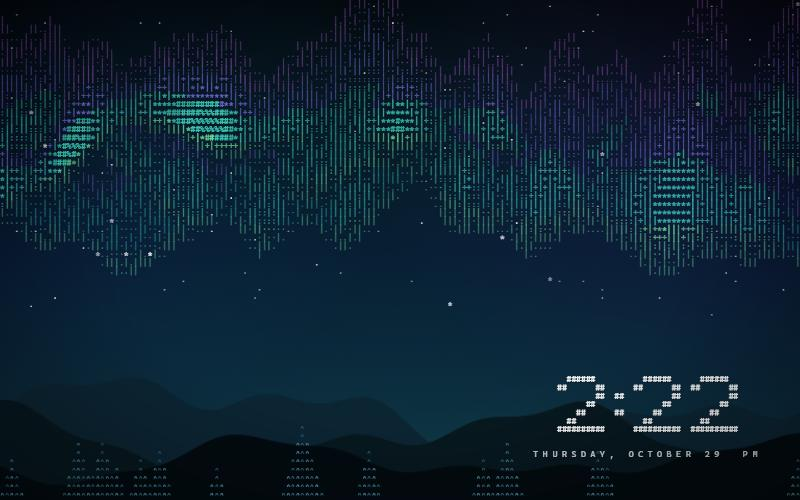
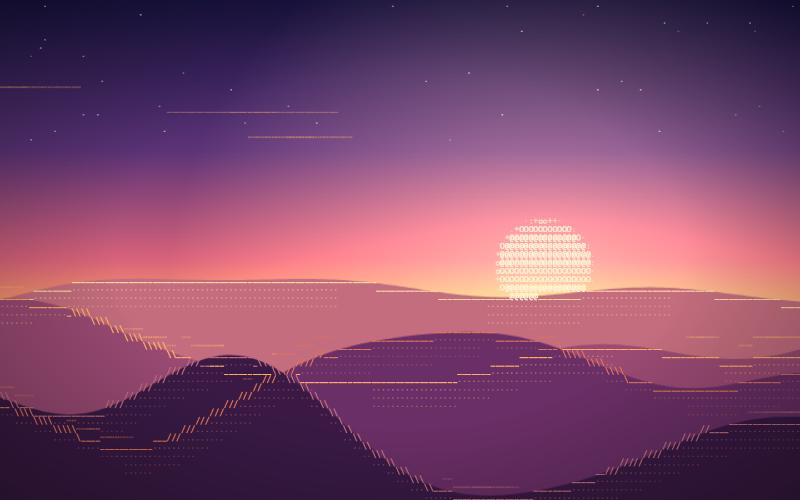

# AsciiWall

Live ASCII-art wallpapers for the Windows desktop. Seventeen animated scenes drawn entirely out of text, running behind your icons, on every monitor, switchable on demand and started with Windows.

| | | |
|---|---|---|
|  |  |  |
|  |  |  |

It is a bit like Wallpaper Engine for ASCII: a library of scenes with live previews, a properties panel, auto-change playlists, per-monitor scenes, and a tray icon, all without a download beyond the installer itself.

## Install

Download `AsciiWall-Setup.exe` from the Releases page and run it. It installs for your account only (no admin prompt), adds a Start menu entry, and can start with Windows. Uninstall from Windows Settings > Apps, or run `Uninstall.exe` in the install folder.

Requirements: Windows 10 or 11 (attach tested on Windows 11 24H2) and Microsoft Edge, which ships with Windows (Chrome also works).

Prefer to build it yourself? You only need what Windows already has:

```powershell
powershell -NoProfile -ExecutionPolicy Bypass -File build.ps1
```

That compiles with the .NET Framework C# compiler and writes `dist\AsciiWall-Setup.exe` plus a portable `dist\AsciiWall\` folder.

## Using it

* **Tray icon** (the wave icon near the clock): left-click opens settings; right-click has everything else: scenes, next/previous/surprise me, auto-change, per-screen scenes, look, clock, performance, start with Windows.
* **Settings and gallery**: a library of live scene previews on the left, and a properties panel on the right (auto-change, speed, brightness, color grade, clock, frame rate, battery behaviour). Click a scene to apply it; click the star on a card to include it in auto-change.
* **Keyboard**: `Ctrl+Alt+Shift` + `Right` / `Left` next and previous scene, `R` random, `P` pause. Switch them off in settings if they clash with something.
* **Command line**: `AsciiWallCtl.exe --next`, `--prev`, `--random`, `--scene dunes`, `--pause`, `--resume`, `--list`, `--status`, `--settings`, `--quit`. Handy for Stream Deck, AutoHotkey or Task Scheduler.

### Things you can change

| | |
|---|---|
| Scenes | 17 built in, each with its own palette and glyphs; add your own (below) |
| Monitors | each screen on its own scene, the same scene on all, or one scene spanning every screen |
| Auto-change | every 1, 5, 15, 30 or 60 minutes, in order or shuffled, over all scenes or just the starred ones |
| Look | detail (soft, balanced, sharp), speed, brightness |
| Color | original, monochrome, green phosphor, amber terminal, ice, rose; plus hue shift and saturation |
| Clock | a big ASCII clock on the main screen (or all), five positions, three sizes, 12/24 hour, optional date |
| Performance | 15, 24, 30 or 60 fps; pause when a window covers the screen; battery: run normally, limit to 15 fps, or pause |

## Make your own scene

Drop a `.js` file into `%LOCALAPPDATA%\AsciiWall\scenes\`, then choose **Restart wallpaper** from the tray. A scene is one object with a backdrop painter and a glyph field. [docs/WRITING-SCENES.md](docs/WRITING-SCENES.md) explains the helpers, and [docs/examples/pulse-rings.js](docs/examples/pulse-rings.js) is a complete example in about 20 lines. Scene files run inside the wallpaper page, so only add files you trust.

## Efficiency

The wallpaper is a web page, so the design goal is to make it do as little as possible:

* **It stops when you cannot see it.** Every second the host checks each monitor; when a maximised window, a full-screen game or video, or a locked session covers it, drawing stops completely (CPU is about 0%).
* **Cheap frames.** The backdrop (gradients, glows) is a half-size canvas refreshed 15 times a second, the vignette and brightness are CSS layers that are never redrawn, and only the glyph layer is repainted each frame at your chosen rate. Color grading is a single GPU-composited CSS filter.
* **Battery aware.** On battery it can drop to 15 fps or pause.
* **Tidy process.** The browser runs in a Windows job object, so it always dies with the app; the page, tray and command line talk over a local loopback socket.

Measured on a 24-thread desktop with two 2560x1440 monitors, both uncovered, Edge renderer tree included:

| Scene @ 30 fps | CPU of the whole machine | about |
|---|---|---|
| Dunes (default) | 1.4% | 0.35 of one core |
| Ember | 1.6% | 0.4 core |
| Digital Rain | 2.3% | 0.55 core |
| Cloud Drift | 2.8% | 0.7 core |
| Aurora (heaviest) | 4.0% | 1 core |

15 fps roughly halves those, and 60 fps costs about 1.7 times as much as 30 (Aurora: 2.1% at 15 fps, 6.8% at 60 fps). Memory is about 400 MB across six Edge processes, which is Chromium's baseline rather than the scenes. A native renderer would cut both and is the main idea on the roadmap.

## How it works

1. `AsciiWall.exe` (a small C# tray app, no dependencies beyond Windows) starts a loopback-only HTTP server and launches Edge in kiosk mode on the wallpaper page.
2. It finds that window, strips its frame and re-parents it to the desktop window (`Progman`) directly beneath the icon view, the same trick other live-wallpaper tools use. On Windows 11 24H2 the icon view and a worker window are both children of `Progman`; older builds use a sibling `WorkerW`, which is implemented but not tested.
3. The page draws each scene onto a character grid and follows a stream of settings pushed over server-sent events. The settings window is the same server's gallery page in an app-style window.
4. The server only answers loopback requests with a matching `Host` header, and every API call needs a random per-run token, so web pages in your browser cannot control it.

If Explorer restarts, the display layout changes, or the browser crashes, the host re-attaches or restarts it with a back-off.

## Troubleshooting

* Log: `%LOCALAPPDATA%\AsciiWall\log.txt` (tray menu > Open data folder).
* Wallpaper missing after a display change: tray menu > Restart wallpaper.
* Settings you can edit by hand live in `%LOCALAPPDATA%\AsciiWall\config.json` (the app must be closed).

## Ideas

Audio-reactive scenes, a native renderer for lower memory, scene packs you can import, time-of-day schedules, a weather scene, video to ASCII. Pull requests welcome.

## License

MIT, see [LICENSE](LICENSE).
